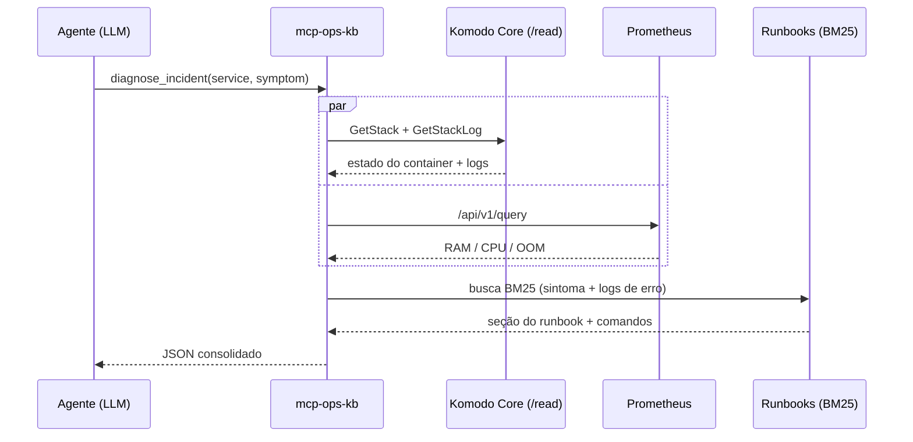

# mcp-ops-kb

Servidor MCP para operação de infraestrutura. Ele junta duas coisas que, durante um incidente, vivem em lugares separados: a telemetria real (Komodo Core e Prometheus) e os runbooks que descrevem como resolver cada tipo de falha.

A ideia é simples: em vez de abrir o Komodo pra ver qual container caiu, colar o log no chat, abrir o Prometheus pra conferir se foi OOM ou CPU throttle e ainda procurar no repositório qual runbook se aplica, você pergunta pro agente e ele faz esses quatro passos sozinho, via tool calling. Funciona com qualquer cliente que fale MCP (Claude Desktop, Cursor, Antigravity...).

## Como funciona

Quando o agente chama `diagnose_incident`, o servidor faz três coisas em paralelo:

1. Consulta o Komodo via `POST /read` (estado da stack + últimas linhas de log)
2. Consulta o Prometheus com PromQL (working set de memória, limites de cgroup, CPU)
3. Usa os próprios logs de erro encontrados como query no índice BM25 dos runbooks

E devolve tudo consolidado num JSON: telemetria, seção do runbook com a causa provável e os comandos já homologados.



Detalhe importante: o servidor só fala com o módulo de leitura do Komodo. As rotas `/write` e `/execute` não existem aqui — o agente pode diagnosticar, mas não derruba nem altera nada em produção.

## Por que não RAG vetorial

Os runbooks são divididos por seção (`## `/`###`), não por chunk de N caracteres. Isso mantém a explicação e o bloco de código juntos, e o BM25 resolve bem buscas por termos exatos (`ExitCode 137`, `502 Bad Gateway`, `missing field 'keys'`). Resultado: sem banco vetorial, sem GPU, sem embedding — o motor inteiro é auditável em algumas centenas de linhas.

Runbooks antigos sem frontmatter YAML também funcionam; o frontmatter (quando existe) só melhora a busca pelos metadados.

## Ferramentas

| Tool | Parâmetros | O que faz |
|---|---|---|
| `diagnose_incident` | `service`, `symptom` | Composta: coleta estado/logs no Komodo, métricas no Prometheus e busca o runbook certo usando os erros encontrados |
| `search_runbooks` | `query`, `service?`, `top_k=3` | Busca BM25 sobre as seções dos runbooks |
| `komodo_read_api` | `rpc_type`, `params?` | Qualquer método de leitura do RPC unificado do Komodo (`ListStacks`, `GetStackLog`, `SearchStackLog`, ...) |
| `query_prometheus` | `promql` | Query instantânea na API HTTP do Prometheus |

Exemplos de chamadas úteis via `komodo_read_api`:

| `rpc_type` | `params` |
|---|---|
| `ListServers` | `{}` |
| `GetSystemStats` | `{"server": "CCM-RP-OPSINTERNO-CORE"}` |
| `ListStacks` | `{}` |
| `GetStack` | `{"stack": "komodo-core"}` |
| `GetStackLog` | `{"stack": "komodo-core", "tail": 50}` |
| `SearchStackLog` | `{"stack": "n8n", "terms": ["OOM", "fatal"]}` |
| `InspectDockerContainer` | `{"server": "...", "container": "komodo-mongo"}` |
| `ListAlerts` | `{}` |

## Exemplo de resposta

`diagnose_incident(service="komodo", symptom="erro no login SSO OIDC")` devolve algo assim (aqui em demo mode):

```json
{
  "service": "komodo",
  "symptom": "erro no login SSO OIDC",
  "komodo_telemetry": {
    "source": "demo_mode",
    "stack": "komodo-core",
    "state": "Running (Warning: OIDC & Periphery Worker02)",
    "logs": [
      "WARN komodo_core::oidc: OIDC initialization failed: missing field 'keys' in JWKS from auth.ccm.local"
    ]
  },
  "prometheus_telemetry": {
    "promql": "container_memory_working_set_bytes{name=~\".*komodo.*\"}",
    "metrics": { "mongo_memory_mb": 685.0, "mongo_limit_mb": 768.0 }
  },
  "recommended_runbooks": [
    {
      "score": 11.69,
      "runbook_id": "RB-KOMODO-001",
      "section": "OIDC não inicializa — `missing field 'keys'`",
      "file": "komodo-core-ops.md"
    }
  ]
}
```

## Estrutura

```
mcp-ops-kb/
├── runbooks/                       # base de conhecimento (Markdown + frontmatter YAML)
│   ├── komodo-core-ops.md          # Komodo Core, OIDC, CA interna, Periphery
│   ├── containers-oom-high-cpu.md  # OOMKilled (Exit 137) e CPU throttling
│   ├── traefik-reverse-proxy.md    # 502/504 e rede Docker do proxy
│   └── database-mongo-redis.md     # cache WiredTiger (Mongo) e eviction (Redis)
├── src/mcp_ops_kb/
│   ├── rag.py                      # motor RAG: frontmatter + seções + BM25
│   ├── telemetry.py                # cliente RPC Komodo (/read) + PromQL
│   └── server.py                   # servidor FastMCP com as 4 tools
└── tests/
```

## Rodando

```bash
uv venv --python 3.12
uv pip install -e ".[dev]"
cp .env.example .env

uv run pytest -v        # testes
uv run ruff check .     # lint
uv run mcp-ops-kb       # servidor
```

## Conectando ao Claude Desktop / Cursor

Aponte para o binário do projeto no `mcp_config.json` (ou `claude_desktop_config.json`):

```json
{
  "mcpServers": {
    "mcp-ops-kb": {
      "command": "uv",
      "args": ["--directory", "/caminho/para/mcp-ops-kb", "run", "mcp-ops-kb"],
      "env": {
        "OPS_KB_RUNBOOKS_DIR": "/caminho/para/mcp-ops-kb/runbooks",
        "KOMODO_URL": "https://komodo.sua-rede.local",
        "KOMODO_API_KEY": "sua_api_key",
        "KOMODO_API_SECRET": "seu_api_secret",
        "PROMETHEUS_URL": "http://prometheus.sua-rede.local:9090",
        "OPS_KB_DEMO_MODE": "true"
      }
    }
  }
}
```

`OPS_KB_DEMO_MODE=true` usa dados sintéticos, o que permite testar todo o fluxo fora da VPN. Em produção, coloque `false` e as credenciais reais.

Também dá para rodar via Docker (o `Dockerfile` já empacota o servidor), mas o caminho mais comum é o `uv` mesmo, porque os clientes MCP executam o processo localmente.

## Escrevendo runbooks novos

Qualquer `.md` dentro da pasta apontada por `OPS_KB_RUNBOOKS_DIR` entra no índice. Formato recomendado:

```markdown
---
id: RB-MEU-SERVICO-001
service: meu-servico
severity: high
tags: [docker, rede, timeout]
symptoms:
  - "Mensagem de erro exata que aparece no log"
---

# Runbook — Meu Serviço

## Nome do cenário de falha

Causa raiz e o que fazer:

```bash
docker logs meu-servico --tail 50
```
```

O campo `symptoms` é o que mais ajuda a busca — coloque lá as mensagens de erro exatas como aparecem no log.

---

Bruno Santos · Engenharia de Operações, DevOps & IA
