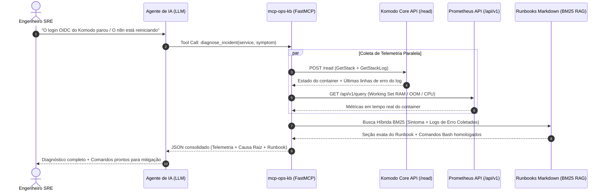

<div align="center">

# ⚡ mcp-ops-kb

**Servidor MCP (Model Context Protocol) para Engenharia de Operações & SRE**  
*RAG Estruturado de Runbooks em Markdown + Telemetria em Tempo Real via Komodo Core API & Prometheus*

[](https://www.python.org/)
[](https://github.com/jlowin/fastmcp)
[](https://komo.do)
[](https://prometheus.io/)
[](#motor-de-rag-estruturado)
[](https://opensource.org/licenses/MIT)

</div>

---

## 🎯 O Problema vs. A Solução

Durante um incidente em produção, engenheiros perdem minutos críticos alternando entre painéis: abrir o **Komodo** para checar qual container caiu, copiar linhas de log, abrir o **Prometheus/Grafana** para validar se houve *OOMKill* ou *CPU Throttling*, e procurar no repositório Git qual **Runbook** explica como destravar o serviço sem causar efeitos colaterais.

O **`mcp-ops-kb`** conecta agentes de IA (Claude Desktop, Cursor, Antigravity, etc.) diretamente à infraestrutura e à base de conhecimento operacional através de **Tool Calling**:

| Sem `mcp-ops-kb` (Chat LLM Comum) | Com `mcp-ops-kb` (Agente SRE Conectado) |
|---|---|
| ❌ Você precisa caçar e copiar logs/métricas manualmente | ✅ O agente coleta estado e logs via **Komodo API** sozinho |
| ❌ O LLM alucina comandos genéricos (`docker compose down`) | ✅ O agente consulta seus **Runbooks reais** via RAG Estruturado |
| ❌ Sem visibilidade de limites de cgroup, RAM ou erros HTTP 502 | ✅ Executa **PromQL no Prometheus** em tempo real |
| ❌ Risco de automações executarem ações destrutivas | ✅ **Read-Only Guardrail**: expõe 100% do `/read`, bloqueando `/write` e `/execute` |

---

## 🏗️ Arquitetura e Fluxo de Diagnóstico



---

## 🧩 Design Enxuto (3 Módulos Principais)

O projeto foi projetado sob o princípio de **simplicidade operacional**: zero banco vetorial pesado, zero dependência de GPU e código 100% auditável em **~290 linhas de Python**:

```text
mcp-ops-kb/
├── pyproject.toml                  # Configuração do pacote e dependências enxutas
├── Dockerfile                      # Containerização pronta para deploy
├── .env.example                    # Variáveis de ambiente documentadas
├── runbooks/                       # Base de conhecimento operacional (Markdown + YAML)
│   ├── komodo-core-ops.md          # Operação Komodo Core, OIDC, CA interna e Periphery
│   ├── containers-oom-high-cpu.md  # Diagnóstico de OOMKilled (Exit 137) e CPU Throttling
│   ├── traefik-reverse-proxy.md    # Troubleshooting HTTP 502/504 e rede Docker proxy
│   └── database-mongo-redis.md     # Contenção de cache WiredTiger (Mongo) e eviction (Redis)
├── src/mcp_ops_kb/
│   ├── rag.py                      # 1. Motor RAG Estruturado (Frontmatter YAML + Seções + BM25)
│   ├── telemetry.py                # 2. Cliente RPC Universal Komodo (/read) + Prometheus PromQL
│   └── server.py                   # 3. Servidor FastMCP expondo as 4 ferramentas
└── tests/
    └── test_mcp_ops_kb.py          # Suíte de testes automatizados (pytest + asyncio)
```

### 1. Motor de RAG Estruturado (`src/mcp_ops_kb/rag.py`)
Em vez de dividir documentos em blocos arbitrários de caracteres (*fixed-size chunking*) que quebram blocos de código ao meio, o `RunbookRAG`:
1. Extrai metadados estruturados do **Frontmatter YAML** (`id`, `service`, `severity`, `tags`, `symptoms`).
2. Divide o documento semanticamente pelas seções `## ` e `### `, mantendo a explicação e os blocos `bash` juntos.
3. Indexa metadados + texto com **BM25Okapi**, garantindo precisão cirúrgica para códigos de erro (`ExitCode 137`, `502 Bad Gateway`, `missing field 'keys'`).
4. Funciona também com **qualquer `RUNBOOK.md` legado** (mesmo sem Frontmatter YAML).

### 2. Telemetria Komodo RPC & Prometheus (`src/mcp_ops_kb/telemetry.py`)
- **Compatibilidade Total com Komodo (`POST /read`):** A API do Komodo Core utiliza um padrão RPC unificado. A função `komodo_read(rpc_type, params)` autentica via headers `X-Api-Key` e `X-Api-Secret` e suporta **qualquer método do módulo `api::read`**.
- **Read-Only by Design:** As rotas `/write` e `/execute` não são expostas ao modelo, garantindo que a IA jamais derrube ou altere stacks em produção acidentalmente.
- **Fallback Demo Integrado (`OPS_KB_DEMO_MODE=true`):** Permite demonstrar, testar e validar todo o fluxo localmente mesmo fora da VPN corporativa.

---

## 🛠️ Ferramentas MCP Expostas (Tool Calling)

| Tool | Parâmetros | O que entrega para o Agente de IA |
|---|---|---|
| **`diagnose_incident`** | `service`, `symptom` | **Ferramenta composta principal:** coleta estado e logs no Komodo, busca métricas de memória no Prometheus e usa os próprios logs de erro encontrados para buscar a seção exata do Runbook. |
| **`search_runbooks`** | `query`, `service?`, `top_k=3` | Busca híbrida BM25 + metadados nas seções dos runbooks operacionais em Markdown. |
| **`komodo_read_api`** | `rpc_type`, `params?` | Executa qualquer operação RPC de leitura (`POST /read`) no Komodo Core. |
| **`query_prometheus`** | `promql` | Executa consultas PromQL instantâneas na API HTTP do Prometheus (`/api/v1/query`). |

### Exemplos de Operações Suportadas via `komodo_read_api`

| Consulta Operacional | `rpc_type` | `params` |
|---|---|---|
| Listar servidores (`komodo-periphery`) | `"ListServers"` | `{}` |
| Estatísticas de CPU/RAM/Disco do host | `"GetSystemStats"` | `{"server": "CCM-RP-OPSINTERNO-CORE"}` |
| Listar todas as stacks Docker Compose | `"ListStacks"` | `{}` |
| Inspecionar estado e config de uma stack | `"GetStack"` | `{"stack": "komodo-core"}` |
| Coletar últimas linhas de log da stack | `"GetStackLog"` | `{"stack": "komodo-core", "tail": 50}` |
| Pesquisar termos de erro nos logs | `"SearchStackLog"` | `{"stack": "n8n", "terms": ["OOM", "fatal"]}` |
| Listar containers Docker de um servidor | `"ListDockerContainers"` | `{"server": "CCM-RP-OPSINTERNO-CORE"}` |
| Inspecionar container (`docker inspect`) | `"InspectDockerContainer"` | `{"server": "CCM-RP-OPSINTERNO-CORE", "container": "komodo-mongo"}` |
| Listar alertas ativos no Komodo | `"ListAlerts"` | `{}` |

---

## 🔍 Exemplo Real de Resposta (`diagnose_incident`)

Quando o agente invoca `diagnose_incident(service="komodo", symptom="erro no login SSO OIDC")`:

```json
{
  "service": "komodo",
  "symptom": "erro no login SSO OIDC",
  "komodo_telemetry": {
    "source": "demo_mode",
    "stack": "komodo-core",
    "server": "CCM-RP-OPSINTERNO-CORE (10.14.218.109)",
    "state": "Running (Warning: OIDC & Periphery Worker02)",
    "logs": [
      "WARN komodo_core::oidc: OIDC initialization failed: missing field 'keys' in JWKS from auth.ccm.local",
      "WARN komodo_core::monitor: Server CCM-RP-APPS-WORKER02 status is NOT OK (Unknown IP on port 8120)"
    ]
  },
  "prometheus_telemetry": {
    "promql": "container_memory_working_set_bytes{name=~\".*komodo.*\"}",
    "metrics": {
      "mongo_memory_mb": 685.0,
      "mongo_limit_mb": 768.0
    }
  },
  "recommended_runbooks": [
    {
      "score": 11.69,
      "runbook_id": "RB-KOMODO-001",
      "service": "komodo",
      "severity": "critical",
      "section": "OIDC não inicializa — `missing field 'keys'`",
      "content": "Quando o login via SSO OIDC falha ou o log do `komodo-core` reporta `missing field 'keys'`, o endpoint JWKS do Authentik retornou `{\"keys\":[]}` porque o OAuth2 Provider está sem **Signing Key** associada.\n\n```bash\ncurl -k https://auth.ccm.local/application/o/komodo/jwks/\n```\n\n**Mitigação:** Acesse o painel do Authentik (`auth.ccm.local`), edite o Provider do Komodo e selecione uma **Signing Key RSA** válida.",
      "file": "komodo-core-ops.md"
    }
  ]
}
```

---

## 🚀 Como Executar e Testar

### 1. Instalação com `uv`

```bash
cd /home/bsantos/Documents/GitHub/mcp-ops-kb

# Criar virtualenv e instalar dependências
uv venv --python 3.12
uv pip install -e ".[dev]"

# Copiar arquivo de variáveis de ambiente
cp .env.example .env
```

### 2. Executar a Suíte de Testes e Linter

```bash
uv run pytest -v
uv run ruff check .
```

### 3. Iniciar o Servidor MCP

```bash
uv run mcp-ops-kb
```

---

## 🔌 Como Conectar ao Claude Desktop / Cursor / Antigravity

Adicione o bloco abaixo ao seu arquivo `mcp_config.json` ou `claude_desktop_config.json`:

```json
{
  "mcpServers": {
    "mcp-ops-kb": {
      "command": "uv",
      "args": [
        "--directory",
        "/home/bsantos/Documents/GitHub/mcp-ops-kb",
        "run",
        "mcp-ops-kb"
      ],
      "env": {
        "OPS_KB_RUNBOOKS_DIR": "/home/bsantos/Documents/GitHub/mcp-ops-kb/runbooks",
        "KOMODO_URL": "https://komodo.ccm.local",
        "KOMODO_API_KEY": "sua_api_key",
        "KOMODO_API_SECRET": "seu_api_secret",
        "PROMETHEUS_URL": "http://prometheus.ccm.local:9090",
        "OPS_KB_DEMO_MODE": "true"
      }
    }
  }
}
```

---

## 📝 Como Adicionar Novos Runbooks

Basta criar qualquer arquivo `.md` dentro da pasta `runbooks/` (ou apontar `OPS_KB_RUNBOOKS_DIR` para a pasta `docs/` dos seus repositórios de infraestrutura). O formato recomendado utiliza um cabeçalho YAML simples seguido de seções `## `:

```markdown
---
id: RB-MEU-SERVICO-001
service: meu-servico
severity: high
tags: [docker, rede, timeout]
symptoms:
  - "Mensagem de erro exata que aparece no log"
---

# Runbook — Meu Serviço

## Nome do Cenário de Falha

Explicação direta da causa raiz e comandos de verificação/mitigação:

```bash
docker logs meu-servico --tail 50
```
```

---

<div align="center">
Desenvolvido por <strong>Bruno Santos</strong> · Engenharia de Operações, DevOps & IA Aplicada
</div>
